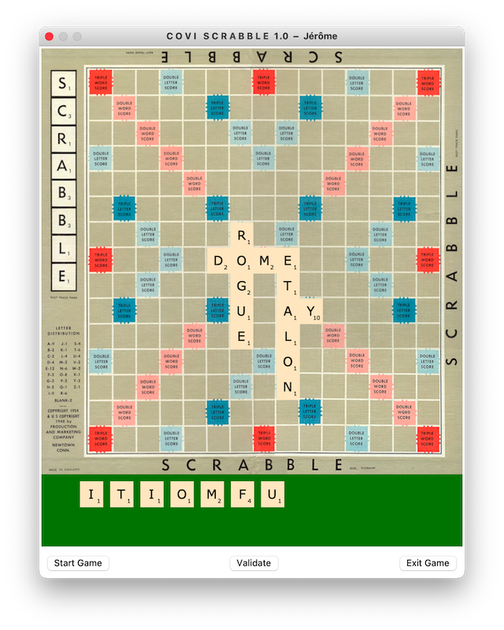

<p align="right">
  🌐 <a href="README.md">Français</a> &nbsp;|&nbsp; <strong>English</strong>
</p>

<div align="center">

# C O V I - S C R A B B L E

**Networked Multiplayer Scrabble Game with Client/Server Architecture in Python**

[](https://github.com/jlehuen/COVISCRABBLE/releases)
[](https://www.python.org/)
[](https://docs.python.org/3/library/tkinter.html)
[](https://docs.python.org/3/library/socket.html)
[](https://docs.python.org/3/library/hashlib.html)
[](./openspec/)
[](./LICENSE.md)

<br/>



</div>

---

## 📖 About

**COVI-SCRABBLE** is a networked multiplayer Scrabble game developed in **Python 3**. Originally designed during the lockdown period of the COVID-19 health crisis (under the code name *YASOL - Yet Another Scrabble On Line*), it was later deeply refactored and modernized into a decoupled, standalone client-server architecture (version 1.1 r1).

The project combines a robust TCP network engine, a smooth vector GUI using Tkinter Canvas with interactive drag-and-drop tiles, a comprehensive official Scrabble adjudication engine (placement validation, letter/word multipliers, cross-word scoring), and a formal engineering process following **OpenSpec** (Spec-Driven Development).

---

## ✨ Key Features

### 🕹️ Gameplay & Graphical Interface (Tkinter)
* **Official 15×15 Board**: Dynamic vector graphics rendered on Tkinter Canvas with colored premium squares (*Double/Triple Letter*, *Double/Triple Word*) and the official center star pentagram at `(7, 7)`.
* **Interactive Tile Rack (*Stand*)**: Intuitive manipulation of the 7 player tiles via **drag-and-drop** with automatic magnetic grid snapping.
* **Blank Tile / Joker Support**: Automatic detection of blank tiles (0 points) with a prompt allowing the player to choose the letter represented.
* **Real-time Synchronized Score Window (*Winscore*)**: Floating companion window magnetically docked to the main window, displaying cumulative scores and details of the latest validated word.
* **Turn-based Logical Lock**: Only the active player can interact with tiles and submit a play; letters placed in prior rounds are automatically locked on the board.

### 🌐 Client-Server Networking (`socketlib/`)
* **Asynchronous Multithreaded Sockets**: Reliable TCP socket connections without freezing the Tkinter main loop, using a thread-safe FIFO queue (`queue.Queue`) periodically polled.
* **Framed Stream Protocol (`$$`)**: Guarantees message boundary integrity against arbitrary TCP packet fragmentation.
* **Secure 3-Step Handshake**:
  1. Version compatibility check (`version:maj:min`).
  2. Username transmission (`mynameis:<login>`).
  3. Authentication via cryptographic **SHA-256** password hashing (`password:<hash>`).
* **Game Lifecycle Management**: Random tile draw based on the selected language letter pool, round-robin turn passing, and final penalty redistribution upon game completion (`gameover`).

### 📚 Official Rules & Bilingual Lexicon
* **English & French Dictionaries**: Full support for both the French Scrabble Lexicon (ODS) and English dictionary.
* **High-Performance Prefix Tree (Trie)**: Lexicographical tree pre-compiled into a binary `.dic` cache (`pickle`) for instant membership lookups in RAM.
* **Comprehensive Scoring Engine (`calculator.py`)**:
  * Verification of strict tile alignment (horizontal or vertical) and contiguity.
  * Validation of connection to existing board tiles (or crossing the center square `(7, 7)` on the opening turn).
  * Detection and simultaneous validation of all secondary cross-words formed.
  * Precise computation of letter and word score multipliers.
  * Automatic **50-point bonus** award for a Bingo / Scrabble (placing all 7 tiles in a single turn).

### 📋 Spec-Driven Development (OpenSpec)
* Fully aligned with the **OpenSpec (SDD)** methodology in [`openspec/`](./openspec/):
  * 8 living requirements tracked (`REQ-NET-001/002`, `REQ-UI-001/002/003`, `REQ-RULES-001/002`, `REQ-GAME-001`).
  * Self-contained HTML5 embedded dashboard [`specs.html`](./specs.html) featuring live search, KPIs, and a task matrix.
  * Lightweight dedicated local HTTP server [`specs_server.py`](./specs_server.py).

---

## 📁 Repository Structure

```text
coviscrabble/
├── main_server.py         # Entry point for the game server
├── main_client.py         # Entry point for the player client
├── scrabble.py            # Main GUI window (Tkinter) & board logic
├── letter.py              # Tile class (drag-and-drop, snapping, jokers)
├── polygon.py             # Vector geometric drawing (center star)
├── winscore.py            # Score companion window
├── calculator.py          # Scrabble adjudication & score calculation engine
├── constants.py           # Game rules, dimensions, letter bags (FR/EN) & multipliers
├── database.py            # User credentials repository with SHA-256 hashes
├── utils.py               # Utility helpers (centering, banner, SHA-256)
├── run_server.sh          # Server quick start shell script
├── run_client.sh          # Client quick start shell script
├── run_server.command     # macOS double-clickable launcher (server)
├── run_client.command     # macOS double-clickable launcher (client)
├── test_core.py           # Automated unit test suite
├── QUICKSTART.txt         # Quickstart guide bundled into all releases
├── specs_server.py        # Embedded local web server for OpenSpec dashboard
├── specs.html             # Pre-built HTML5 OpenSpec dashboard
│
├── socketlib/             # Reusable generic socket library
│   ├── abstract_serveur.py # Multithreaded TCP server, handshake & broadcast
│   └── abstract_client.py  # TCP client, background listener & async queue
│
├── scra_server.py         # Scrabble server domain specialization
├── scra_client.py         # Scrabble client domain specialization
│
├── dico/                  # Lexicographical dictionary engines & word lists
│   ├── dictionary.py      # Prefix tree (Trie) & .dic cache management
│   ├── dico_fr.txt        # Official reference word list (French)
│   └── dico_en.txt        # Official reference word list (English)
│
├── img/                   # Graphic assets and illustrations
│   ├── board.png          # Board snapshot
│   ├── splash.png         # Splash screen image
│   └── gameover.png       # Game over illustration
│
└── openspec/              # Formal OpenSpec specifications (SDD)
    ├── config.yaml        # Project configuration
    ├── specs/             # Living requirements (coviscrabble.md)
    ├── changes/           # Change lifecycle records (proposal, design, tasks)
    ├── openspec_parser.py # Universal real-time parser without dependencies
    └── render_html.py     # Self-contained HTML5 dashboard renderer
```

---

## 🚀 Quick Start

### Prerequisites
* **Python 3.9+** with Tkinter support (`python3-tk` on Linux, included natively on macOS and Windows).

```bash
# Check Tkinter availability
python3 -c "import tkinter; print('Tkinter OK')"
```

---

### 1. Launch the Server

In a first terminal window:

```bash
# Start directly in English on port 1234
python3 main_server.py -en -port 1234 -data database

# Or using the provided script (French mode):
./run_server.sh
```

> **Available server options:**
> * `-fr` / `-en`: Select dictionary language and letter bag (default: `EN`).
> * `-port <num>`: TCP port to listen on (default: `1234`).
> * `-data <module>`: Python module containing the `USERS` dictionary (default: `database`).

---

### 2. Launch One or More Clients

In separate terminal windows (for each player):

```bash
# Connect to the local server
python3 main_client.py -en -host localhost -port 1234

# Or using the provided script (French mode):
./run_client.sh
```

A login dialog will prompt upon launch.

#### Pre-configured Test Accounts:
| Player | Username | Password |
| :--- | :--- | :--- |
| **Player 1** | `toto` | `toto` |
| **Player 2** | `titi` | `titi` |

*(SHA-256 hashes are stored in [`database.py`](./database.py). To add new accounts, simply register the username along with the SHA-256 digest of their password).*

---

### 3. Play a Game

1. Connect at least two players (`toto` and `titi`).
2. Click the **`Start Game`** button on either client.
3. The server draws and distributes 7 tiles to each player's rack and unlocks the active player.
4. Drag and drop your tiles onto the board (the opening play must cover the center star at `(7, 7)`).
5. Click **`Validate`**: your score is automatically calculated, checked against the dictionary, broadcast to all participants, and turn passes to the next player.

---

## 🧪 Automated Testing

A unit test suite validates cryptography, lexicographical lookups (FR/EN), and OpenSpec consistency:

```bash
python3 test_core.py
```

Expected output:
```text
....
----------------------------------------------------------------------
Ran 4 tests in 1.65s

OK
```

---

## 📊 OpenSpec Dashboard

To inspect requirement coverage, completed tasks, and architectural specifications:

```bash
# Start local server and open the dashboard in your default browser
python3 specs_server.py -open
```

The dashboard will be available at [http://localhost:8088/specs](http://localhost:8088/specs).  
You can also open [`specs.html`](./specs.html) directly in any modern web browser.

---

## ⚖️ Legal Notice & License

* This software is distributed under the **GNU General Public License v3 (GPLv3)**. See [`LICENSE.md`](./LICENSE.md) for full terms.
* **Trademark notice**: *SCRABBLE® is a registered trademark. All intellectual property rights in and to the game are owned in the U.S.A. and Canada by Hasbro Inc., and throughout the rest of the world by J.W. Spear & Sons Limited of Maidenhead, Berkshire, England, a subsidiary of Mattel Inc. Mattel and Spear are not affiliated with Hasbro.*
