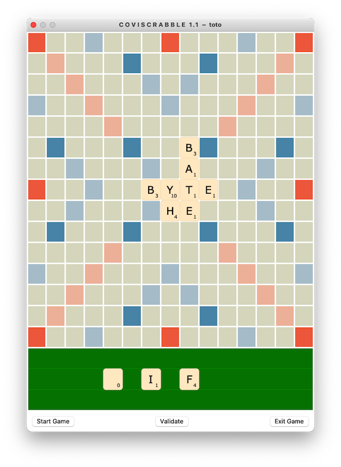

<p align="right">
  🌐 <strong>Français</strong> &nbsp;|&nbsp; <a href="README.en.md">English</a>
</p>

<div align="center">

# C O V I - S C R A B B L E

**Jeu de Scrabble multijoueur en réseau avec architecture Client/Serveur en Python**

[](https://github.com/jlehuen/COVISCRABBLE/releases)
[](https://www.python.org/)
[](https://docs.python.org/3/library/tkinter.html)
[](https://docs.python.org/3/library/socket.html)
[](https://docs.python.org/3/library/hashlib.html)
[](./openspec/)
[](./LICENSE.md)

<br/>



</div>

---

## 📖 À propos

**COVI-SCRABBLE** est un jeu de Scrabble multijoueur en réseau développé en **Python 3**. Conçu initialement durant la période de confinement liée à la crise sanitaire de la COVID-19 (sous le nom de code *YASOL - Yet Another Scrabble On Line*), il a ensuite été profondément restructuré et modernisé en architecture client-serveur autonome (version 1.1 r1).

Le projet combine un moteur réseau TCP robuste, une interface graphique vectorielle fluide sous Tkinter avec glisser-déposer de tuiles, un système d'arbitrage officiel Scrabble complet (règles de placement, multiplicateurs, comptage de mots croisés), et une démarche d'ingénierie dirigée par les spécifications (**OpenSpec**).

---

## ✨ Fonctionnalités Clés

### 🕹️ Expérience de Jeu & Interface Graphique (Tkinter)
* **Plateau officiel 15×15** : Rendu vectoriel dynamique sur Canvas avec identification colorée des cases multiplicatrices (*Lettre compte double / triple*, *Mot compte double / triple*) et pentagramme central officiel en `(7, 7)`.
* **Chevalet interactif (*Stand*)** : Manipulation intuitive des 7 tuiles de jeu par **glisser-déposer** (*drag-and-drop*) avec aimantation automatique sur la grille.
* **Gestion des Jokers (Lettres blanches)** : Détection automatique des tuiles blanches (0 point) avec dialogue de sélection de la lettre représentée.
* **Tableau des scores synchronisé (*Winscore*)** : Fenêtre satellite flottante arrimée magnétiquement à la fenêtre principale, affichant en temps réel les scores cumulés de chaque joueur et le détail du dernier mot validé.
* **Verrouillage logique** : Seul le joueur dont c'est le tour peut déplacer ses tuiles et valider son coup ; les lettres posées lors des tours précédents sont automatiquement verrouillées.

### 🌐 Architecture Réseau Client-Serveur (`socketlib/`)
* **Communication asynchrone multithreadée** : Connexions TCP fiables sans blocage de l'interface utilisateur Tkinter grâce à une file d'attente FIFO thread-safe (`queue.Queue`) interrogée par polling cadencé.
* **Protocole délimité par trames (`$$`)** : Intégrité garantie des flux réseau évitant les coupures ou fusions arbitraires de paquets TCP.
* **Handshake sécurisé en 3 temps** :
  1. Négociation de compatibilité de version logicielle (`version:maj:min`).
  2. Transmission du nom d'utilisateur (`mynameis:<login>`).
  3. Vérification du mot de passe haché cryptographiquement en **SHA-256** (`password:<hash>`).
* **Gestion du cycle de partie** : Distribution aléatoire des tuiles selon le sac de langue sélectionné, passage de tour ordonnancé, et redistribution des points restants du chevalet en fin de partie (`gameover`).

### 📚 Arbitrage Officiel & Multilinguisme
* **Dictionnaires FR & EN** : Prise en charge officielle du lexique français (Officiel du Scrabble - ODS) et anglais.
* **Indexation haute performance** : Arbre lexicographique précompilé sous forme de cache binaire `.dic` (`pickle`) pour une validation instantanée des mots en mémoire vive.
* **Calculateur de points complet (`calculator.py`)** :
  * Contrôle de la contiguïté et de l'alignement strict (ligne ou colonne).
  * Vérification de la connexion aux mots déjà présents sur le plateau (ou passage obligé par la case centrale au 1ᵉʳ tour).
  * Détection et validation simultanée de tous les mots secondaires formés perpendiculairement.
  * Application précise des multiplicateurs de lettres et de mots.
  * Attribution automatique de la prime de **50 points** en cas de Scrabble (7 lettres posées d'un coup).

### 📋 Ingénierie & Spécifications Vivantes (OpenSpec)
* Conforme à la méthodologie **Spec-Driven Development (SDD)** avec arborescence formelle [`openspec/`](./openspec/) :
  * 8 exigences vivantes tracées (`REQ-NET-001/002`, `REQ-UI-001/002/003`, `REQ-RULES-001/002`, `REQ-GAME-001`).
  * Tableau de bord HTML5 embarqué autonome [`specs.html`](./specs.html) avec recherche instantanée, KPIs et matrice des tâches.
  * Serveur HTTP local dédié [`specs_server.py`](./specs_server.py).

---

## 📁 Arborescence du Projet

```text
coviscrabble/
├── src/                       # 🌟 Code source applicatif
│   ├── main_client.py         # Point d'entrée du client joueur
│   ├── main_server.py         # Point d'entrée du serveur de jeu
│   ├── scrabble.py            # Fenêtre principale IHM Tkinter & logique de plateau
│   ├── letter.py              # Classe Tuile (drag-and-drop, snapping, jokers)
│   ├── polygon.py             # Dessin géométrique vectoriel (étoile centrale)
│   ├── winscore.py            # Fenêtre satellite d'affichage des scores
│   ├── calculator.py          # Moteur d'arbitrage et calcul des scores Scrabble
│   ├── constants.py           # Règles, dimensions, sacs de lettres FR/EN et grilles bonus
│   ├── database.py            # Référentiel des utilisateurs et mots de passe SHA-256
│   ├── utils.py               # Boîte à outils (centrage Tkinter, bannière, SHA-256, paths)
│   ├── scra_client.py         # Spécialisation client pour les commandes Scrabble
│   ├── scra_server.py         # Spécialisation serveur pour les règles de Scrabble
│   │
│   ├── socketlib/             # Bibliothèque réseau générique réutilisable
│   │   ├── abstract_serveur.py # Serveur TCP multithreadé, handshake & broadcast
│   │   └── abstract_client.py  # Client TCP, thread d'écoute & file asynchrone
│   │
│   ├── dico/                  # Moteurs lexicographiques et listes de mots
│   │   ├── dictionary.py      # Arbre préfixe (Trie) et gestion du cache .dic
│   │   ├── dico_fr.txt        # Dictionnaire officiel de référence (Français)
│   │   └── dico_en.txt        # Dictionnaire officiel de référence (Anglais)
│   │
│   └── img/                   # Ressources graphiques et illustrations
│       ├── board.png          # Capture de plateau
│       ├── splash.png         # Écran d'accueil (Splash screen)
│       └── gameover.png       # Écran de fin de partie
│
├── tests/                     # 🧪 Suite de tests unitaires automatisés
│   └── test_core.py
│
├── img/                       # Visuels pour la documentation (README)
│   └── board.png              # Capture d'écran du plateau
│
├── build_dist.py              # Packaging multiplateforme PyInstaller (CI & local)
├── QUICKSTART.txt             # Guide de démarrage rapide embarqué dans les releases
├── specs_server.py            # Serveur web local embarqué pour le dashboard OpenSpec
├── specs.html                 # Tableau de bord HTML5 généré d'OpenSpec
├── run_server.sh / .bat       # Scripts de lancement rapide du serveur
├── run_client.sh / .bat       # Scripts de lancement rapide du client
├── run_server.command         # Lanceur macOS double-cliquable (serveur)
├── run_client.command         # Lanceur macOS double-cliquable (client)
│
├── .github/workflows/         # Intégration continue & Déploiement (CI/CD)
│   └── release.yml            # Compilation automatique multiplateforme des releases
│
└── openspec/                  # Spécifications formelles OpenSpec (SDD)
    ├── config.yaml            # Configuration générale du projet
    ├── specs/                 # Exigences vivantes (coviscrabble.md)
    ├── changes/               # Traçabilité des évolutions (proposal, design, tasks)
    ├── openspec_parser.py     # Parseur universel temps réel sans dépendance
    └── render_html.py         # Générateur du dashboard HTML5 autonome
```

---

## 🚀 Démarrage Rapide

### Prérequis
* **Python 3.9+** avec support Tkinter actif (`python3-tk` sur Linux, natif sur macOS et Windows).

```bash
# Vérifier la présence de Tkinter
python3 -c "import tkinter; print('Tkinter OK')"
```

---

### 1. Démarrer le Serveur

Dans un premier terminal :

```bash
# Lancement direct en français sur le port 1234
python3 src/main_server.py -fr -port 1234 -data database

# Ou via le script fourni :
./run_server.sh
```

> **Options disponibles pour le serveur :**
> * `-fr` / `-en` : Sélection de la langue du dictionnaire et du sac de tuiles (défaut : `EN`).
> * `-port <num>` : Port TCP d'écoute (défaut : `1234`).
> * `-data <module>` : Module contenant le dictionnaire `USERS` (défaut : `database`).

---

### 2. Démarrer un ou plusieurs Clients

Dans un second terminal (pour chaque joueur) :

```bash
# Connexion au serveur local
python3 src/main_client.py -fr -host localhost -port 1234

# Ou via le script fourni :
./run_client.sh
```

Une fenêtre d'identification s'affiche au démarrage.

#### Comptes de test préconfigurés :
| Joueur | Identifiant | Mot de passe |
| :--- | :--- | :--- |
| **Joueur 1** | `toto` | `toto` |
| **Joueur 2** | `titi` | `titi` |

*(Les empreintes SHA-256 sont stockées dans [`database.py`](./database.py). Pour ajouter de nouveaux comptes, ajoutez simplement l'identifiant et le condensat SHA-256 de son mot de passe).*

---

### 3. Lancer une Partie

1. Connectez au moins deux joueurs (`toto` et `titi`).
2. Cliquez sur le bouton **`Start Game`** sur l'un des clients.
3. Le serveur distribue 7 lettres sur le chevalet de chaque joueur et active le premier joueur.
4. Faites glisser vos tuiles sur le plateau (le premier mot doit obligatoirement recouvrir l'étoile centrale `(7, 7)`).
5. Cliquez sur **`Validate`** : le score est automatiquement calculé, validé auprès du dictionnaire, diffusé à tous les participants, et la main passe au joueur suivant.

---

## 🧪 Tests & Validation Automatisée

Une suite de tests unitaires valide l'intégrité de la cryptographie, des dictionnaires lexicographiques FR/EN et de l'arbre OpenSpec :

```bash
python3 -m unittest discover -s tests
```

Résultat attendu :
```text
....
----------------------------------------------------------------------
Ran 4 tests in 1.65s

OK
```

---

## 📊 Tableau de Bord OpenSpec

Pour visualiser la couverture des exigences, l'avancement des tâches et l'architecture du projet :

```bash
# Lancer le serveur local et ouvrir automatiquement la page dans le navigateur
python3 specs_server.py -open
```

Le tableau de bord est alors accessible à l'adresse [http://localhost:8088/specs](http://localhost:8088/specs).  
Vous pouvez également ouvrir directement le fichier statique [`specs.html`](./specs.html) dans n'importe quel navigateur.

---

## ⚖️ Mentions Légales & Licence

* Ce logiciel est distribué sous licence **GNU General Public License v3 (GPLv3)**. Consultez le fichier [`LICENSE.md`](./LICENSE.md) pour plus de détails.
* **Mention légale** : *SCRABBLE® is a registered trademark. All intellectual property rights in and to the game are owned in the U.S.A. and Canada by Hasbro Inc., and throughout the rest of the world by J.W. Spear & Sons Limited of Maidenhead, Berkshire, England, a subsidiary of Mattel Inc. Mattel and Spear are not affiliated with Hasbro.*
